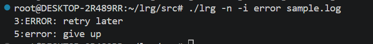
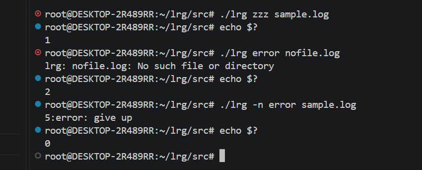
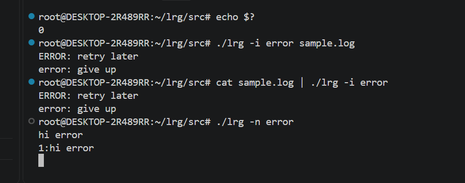

# lr-grep 招新题题解
>**食用指南**：这篇题解的撰写方式与之前的题解不太一样，我之前都是学完知识、写完整个程序再写题解，而这次我是边学、边写代码、边写题解（因为我觉得这样可以更全面的记录学到的知识，以及更好的呈现我自己的心路历程。）但是，不出意外就要出意外了————我整个程序**写了一半之后才发现自己一开始的策略和方向全错了**！一开始我的想法是让ai告诉我整个程序大概要拆分为多少个函数，每个函数大概有什么功能，然后试着自己根据每个函数的功能先写一下代码，再让ai把我遗漏的地方补上去，在整体框架上进行细节完善。但是想法很美好，现实很骨感。我高估了自己的能力，（可能还有没有完全理解题目要求的原因），我写的程序有很多bug，很多该有的东西我没有加上去，而且很多地方都无法串起来。所以当我给ai检查的时候，发现自己几乎要**推倒重来**，但是，此时我的 **markdown 已经写了很多**，我又实在**不忍心把之前自己学习的痕迹全部删掉**。所以深思熟虑了一番后我还是决定**保留前面的内容**，但是这样一来就导致整个 markdown **非常冗长而且阅读起来逻辑非常不通畅**。所以，如果学长**有时间想看看我前面的翻车过程，那可以从头开始看（我会非常感动的！呜呜呜！）**。如果学长**不想浪费时间**的话，我建议**开头部分可以只看有关parse_arguments和二级指针的内容，然后直接跳到 `Step1：重构 read_file 函数` 的部分开始看**，这样看**逻辑会通畅很多**，而且也基本能**展示我的思考过程**。

## 一些前置的知识
>因为一开始不太理解题目要求以及 LINUX 中 grep 语句的行为，所以我先阅读了一些资料，下面这些是我整理出来的前置知识
1. 为什么文件描述符通常从 3 开始？
- 在 Linux 中，进程通常启动时已经拥有三个标准文件描述符：

| 文件描述符 | 名称    | 用途                     |
| ---------- | ------- | ------------------------ |
| 0          | stdin   | 标准输入，例如键盘       |
| 1          | stdout  | 标准输出，例如终端       |
| 2          | stderr  | 标准错误，例如错误提示   |
| 3 及以后   | —       | 由程序打开的对象，例如通过 open() 打开的文件 |

- 所以，如果这三个标准描述符都还处于打开状态，第一次调用 open() 通常会获得 3。

- 总结起来，文件名是用于告诉操作系统“要打开哪个文件”的；而文件描述符用于告诉操作系统“接下来要操作哪个已打开的对象”。这就是 open() 与 read() 能够配合工作的关键。

2. 可能要用到的几个宏：
- STDOUT_FILENO：标准输出，通常是终端，值为 1。
- STDERR_FILENO：标准错误，通常也是终端，值为 2。
- fd：通过 open() 打开的文件所对应的描述符。

| 宏            | 对应数值 | 含义       |
| ------------- | -------- | ---------- |
| STDIN_FILENO  | 0        | 标准输入   |
| STDOUT_FILENO | 1        | 标准输出   |
| STDERR_FILENO | 2        | 标准错误   |

3. LINUX 中的 grep 的简要工作原理
>grep = Global Regular Expression Print（全局正则表达式打印）
>核心任务：逐行读取输入文本，用正则表达式匹配，输出符合条件的行。
>整体流程
- 读取输入源
来源可以是：`指定文件列表 / 管道标准输入`（echo xxx | grep ...）。如果传入多个文件，会依次打开逐个处理。打开失败就记录错误。

- 逐行读取缓冲区
按行读文本（换行符\n作为行分隔），一行一行做匹配，不是一次性加载整个大文件，所以可以处理 GB 级超大文件，内存占用很小。

- 正则匹配引擎
默认是基础正则表达式（BRE）；-E 切换扩展正则 ERE；-F 按纯字面字符串匹配（不解析正则）。对每一行把正则表达式和当前行文本比对。

- 根据参数决定输出行为
  - 默认：打印匹配成功的整行；
  - -n：附加行号；
  - -c：不打印行，只统计匹配行数；
  - -i：匹配时把字符统一转大小写，忽略大小写差异；
  - -v：反向匹配（输出不匹配的行）。

- 设置退出码（exit status）
执行结束后返回状态码，供脚本判断：
|返回码|含义|
|---|---|
|0|	至少找到一处匹配|
|1|	文件读取成功，没有任何匹配|
|2|	打开文件失败、参数错误等运行错误|
>关键点区分
  - 返回码 1 ≠ 程序出错，只是没有找到匹配内容；
  - 返回码 2 才是真正的 IO / 参数错误。
>补充特点
  - `grep` 是行工具：匹配是`作用在整行`，只要一行内包含匹配的子串，整行就被选中；
  - `不会修改`原文件，只是读取并输出结果；
  - 属于经典 UNIX 过滤器，常`配合管道 | `和其他命令组合。

4. 本次要实现的 `grep` 与原生 `grep` 的区别

>最大区别：lrg 是题目限定阉割版，只实现字面字符串匹配，不是完整 grep

- 匹配能力上最大区别
  - 系统 grep：默认是`基础正则 BRE`，`支持` . * [] ^ $ 等`正则元字符`；加 -E 扩展正则，-F 才是固定字面串。
  - 招新题 lrg：永远是`纯字面量字符串匹配`，完全`不解析正则符号`。
  - 比如 `PATTERN=err.*`，原生 `grep` 会当成`正则`，`lrg` 只会去原文里`查找字面字符` `err.*`。（题目描述：本题是字面量匹配，不需要引入正则引擎）

- 选项集合
  - 系统 grep：大量选项 -v -o -A -B -q -w 等等。
  - lrg：只允许 -n -i -c，只能合并这三个，别的选项（-x、-q）直接判定非法选项，直接报用法错误退出 2。
  - 原生 grep 遇到未知选项也报错，但规则细节不一样；
  - 并且 lrg 解析规则：从左往右扫 argv，第一个不以 - 开头的参数就是 PATTERN，后面全部是 FILE。
  - 原生 grep 的选项解析逻辑更复杂，允许选项出现在 PATTERN 之后（GNU grep 支持），你的 lrg 不允许！

- IO 底层接口
  - 系统 grep：内部可以用 stdio 或者系统调用混合实现，C 标准库缓冲。
  - lrg 硬性约束：读文件必须使用 open/read/close 系统调用，禁止 fopen/fgets/getline，自己手动缓冲区、处理 EINTR 重试、手动处理行分割，流式读取，不能一次性把整个文件加载进内存。输出无强制限制，write/printf 都可以。

## parse_lines
>通过新建一个parse_lines函数来读取、拆分数据
1. 必要的参数：
- args->show_line_number 把 n 解析出来，供后面函数使用
- args->ignore_case 把 i 解析出来，供后面函数使用
- args->count_only 把 c 解析出来，供后面函数使用
- args->pattern 把 `pattern` 解析出来，供后面 printf 的时候用
- args->first_file 第一个文件的地址解析出来，后面 printf 的时候要用

2. 解析pattern之前的选项
>核心逻辑：先找字符串的第一个字符是"-"的字符串，再判断这个字符串是不是 "-n, -i 和 -c"（这里要注意，**要排除 argc <= 1（此时整个输入语句只有一个文件名）以及排除字符串第一个字符是'\0' 的情况（此时 -n,-i,-c 不存在，按默认处理）**）
- 找到 `-n,-i,-c` 并分别赋值给 `show_line_number`;`ignore_case`; `count_only` 。（这里用一个循环实现，用 `argv[i][j] != 'n'这样的写法 ` 把 `-nic` 和 `-n -i -c `这两种情况统一起来）
- 此时，下标为 i 的参数就是 `pattern` ，所以直接传地址即可。
- 然后，再通过 `i+1` 拿到 `first_file` 的地址，参数解析就基本完成了
- 最后再处理一下报错的情况：比如非法输入 "-x" 和 argc <= i 时的情况即可（返回-1，解析失败）。


## process_lines
>通过新建一个process_line函数来处理读取完的数据（把分成两段的行拼接起来变成完整行，末尾补'\0'等）
>下面是我一开始写的代码：
```c
void process_lines(const char *buf, ssize_t n,char *line, size_t *line_len) //buf：本次 read() 读取的数据。n：本次实际读取的字节数。line：暂存尚未处理完的行。line_len：当前暂存行的长度。
{
    int x=0;
    int i=0;
    for(i;i<n;i++)
    {
        if(buf[i]=='\n')
        {
            x++;
            printf("这是第%d行",x);

        }
    }
        
    if(buf[n-1]!='\n')
    {   
        if(n!=0)
        {
            for(int j=0;j<n-x;j++)
            {
            line[j]=buf[i+1];
            i++;
            }
        }
        
        else{
            for(int j=0;j<n;j++)
            {
                line[j]=buf[j];

            }
        }
    line_len=sizeof(buf);
    
    }
    return;
    
}
```
>错误：
1. x++;不过，如果最终要实现 grep -n，还需要让行号能够在多次调用函数之间保留，因此不能一直把它定义为每次调用都会重置的局部变量。
2. `line_len = sizeof(buf) `不正确!
- 我写的是：`line_len = sizeof(buf);`这里有两个问题：(1)line_len 的类型是 size_t *，它是一个指针，应该修改它指向的变量，即 `*line_len`。`sizeof(buf)` 得到的是指针或数组本身的大小，具体取决于 buf 的类型；它不代表当前行的实际长度。例如，应该通过：`(*line_len)++;`来记录追加了一个字节。(2)但这还不是完整的实现，因为遇到换行符时，还需要重置行长度，并处理已经完成的行。

>注意事项：
1. 为什么line_len要设置成指针类型而不是ssize_t类型？
- 关键原因是：line_len 需要在函数调用结束后保留更新后的值，因此我们把它设计成指针，让函数能够修改调用者的变量。结合process_lines()函数 来理解。
- 如果使用普通的 ssize_t，假设函数这样定义：
```C
void process_lines(const char *buf, ssize_t n,
                   char *line, ssize_t line_len)
{
    line_len = line_len + 1;
}
```
调用时：
```C
ssize_t len = 0;
process_lines(buf, n, line, len);
printf("%zd", len);
```
输出仍然是0！（**因为 C 语言的`普通参数传递`是`值传递`。调用函数时，`line_len `得到的是 len 的`一份副本`。`调用者的变量 len = 0`，函数收到`副本 line_len = 0`。函数修改`副本为 1`，函数结束后，`调用者的 len` 仍然是 `0`。）


- 如果使用指针 size_t *
```C
void process_lines(const char *buf, ssize_t n,
                   char *line, size_t *line_len)
{
    (*line_len)++;
}
```
调用时：
```c
size_t len = 0;
process_lines(buf, n, line, &len);
printf("%zu", len);
```
输出就是：1(`&len：获取变量 len 的地址。``line_len：`接收这个地址。`*line_len：访问`这个地址对应的变量，也就是调用者的 len。因此，函数执行：`(*line_len)++;`实际上就是把`调用者的 len `加 1。

>顺带比较一下ssize_t与size_t的不同
| 类型    | 主要用途                                                     |
| ------- | ------------------------------------------------------------ |
| ssize_t | 表示 read() 的返回值，因为它可能是负数（出错时为 -1） |
| size_t  | 表示数组长度、字符串长度等非负大小                           |


>现在已经完成了 process_lines() 的核心逻辑：逐字节扫描 buf，遇到普通字符就追加到 line，遇到 \n 就处理完整的一行。
```c
void process_lines(const char *buf, ssize_t n,char *line, size_t *line_len) //buf：本次 read() 读取的数据。n：本次实际读取的字节数。line：暂存尚未处理完的行。line_len：当前暂存行的长度。
{
    for (ssize_t i = 0; i < n; i++) {
        if (buf[i] == '\n') {
            // 1. 给 line 添加字符串结束符 '\0'
            line[(*line_len)]='\0';   
            // 2. 处理完整的一行，例如打印 line
            printf("%s\n",line);
            // 3. 将 *line_len 重置为 0
            *line_len=0;
        } else {
            // 4. 将 buf[i] 追加到 line 的末尾
               line[(*line_len)]=buf[i]; 
               (*line_len)++;
                
            }
         
    }
}
```


## read_file
>通过新建一个read_file函数实现文件读取，为process_line准备必要参数：read_file() 需要调用 process_lines()，所以需要在 read_file() 中准备一个专门保存当前行的数组，以及记录当前行长度的变量等参数。

1. 为什么不能只写 `char *line;`
```c
char *line;
size_t line_len = 0;

仅声明指针变量 `line`，**没有分配字符存储空间**。
```
- `line`：指针变量，没有指向合法内存
- 直接执行 `line[0] = 'h';`：对野指针写入，触发**未定义行为**


2. 为什么 `process_lines()` 可以使用指针

函数原型：

```c
void process_lines(const char *buf, ssize_t n,
                   char *line, size_t *line_len)
```

- `char *line` 仅用于接收内存地址，**存储空间由调用者提供**
- 调用示例：

```c
char line[4096];
size_t line_len = 0;
process_lines(buf, n, line, &line_len);
```

- 数组传参时自动转为首元素指针传入函数process_line中。之所以是char *line有可能是因为数组传参时退化成了指针
- `read_file()` 的数组提供内存；`process_lines()` 的指针访问内存


> 注意：指针 ≠ 内存空间，指针只是内存地址

3. read_file () 想用指针：动态内存分配 malloc

```c
char *line = malloc(4096 * sizeof(char));
if (line == NULL) {
    perror("malloc");
    close(fd);
    return -1;
}
size_t line_len = 0;
```

- `malloc` 在堆上分配内存，`line` 指向这块内存，可以传给 `process_lines()`
- 使用完毕必须释放内存：`free(line);`
- 局限：固定 4096 字节；超长行需要用 `realloc()` 动态扩容

| 写法 | 特点 | 是否适合当前阶段 |
| ---- | ---- | ---- |
| `char line[4096]` | 自动分配固定大小栈内存 | 适合，优先用来验证业务逻辑 |
| `char *line = malloc(...)` | 堆上动态分配，需要手动free | 适合后续扩展 |
| `char *line = NULL` | 仅指针，无可用存储空间 | 不可直接写入字符 |

>这里为了与后续realloc操作搭配方便，我就一步到位选择了malloc分配内存的写法。并且为了防止名字重复造成混乱，在read_file函数中我用*current和size_t current_len来初始化与命名变量。下面是修改后的代码：
```c
int read_file(const char *pathname)
{
    int fd = open(pathname, O_RDONLY);

    if (fd == -1) {
        perror("open");
        return -1;
    }

    char *current=NULL;
    char *try=malloc(4096*sizeof(char));
    if(try==NULL)
    {
        perror("malloc");
        return -1;
    }
    else
    current=try;
    size_t current_len=0;

    while ((n = read(fd, buf, sizeof(buf))) > 0) {
        process_lines(buf, n, current, &current_len);
    }

    if (n == -1) {
        perror("read");
        close(fd);
        return -1;
    }

    close(fd);
    return 0;
}
```


## 修改read_file和process_lines让两者能够配合起来
>目前的函数还缺少两个关键步骤:（1）处理最后一行： 如果文件最后没有 \n，需要在读取结束后处理 current 中剩余的字符。（2）检查行缓冲区容量： 虽然申请了 4096 字节，但如果某一行超过 4095 个字符，仍然可能越界。后续需要增加容量管理，必要时用 realloc() 扩容。

1. free(current) 和 free(try) 不能都保留
我写的是：
```C
free(current);
free(try);
```
一开始：

```C
current = try;
```

两个指针指向的是同一块内存。因此，如果没有发生 realloc()，释放 current 后再释放 try，就会重复释放同一块内存，造成未定义行为。如果 realloc() 成功移动了内存，try 还可能指向旧地址。应该直接删除 try，只保留 current 这个指针。 在所有退出路径中确保它只被释放一次。

2. process_lines()不能通过 '\0' 判断文件末尾
我写的是：
```C
if (buf[i] == '\0' && i == n - 1) {
    buf[i] ='\n';   //一开始我想利用'\0'来判断文件末尾，然后假造一个换行符让程序能接到下面的if (buf[i] == '\n')语句中，把字符输出出来
}
```
这里有两个问题：
- `read()` 读取的是字节，不会自动在文件`末尾添加 '\0'。`
- buf[i] = '\n'; 也不应该这样做，因为这会修改原始数据。
- 正确思路： read() 返回 0 时，才表示普通文件已经读到末尾。最后一行没有换行符的情况，应该在 read_file() 中处理，而不是在 process_lines() 中假造一个换行符。


3. 扩容应该发生在 process_lines() 追加字符之前，或者由 process_lines() 自己负责扩容。你现在是在处理完一整块 buf 后才检查，这可能已经太迟了。


4. 改好后的版本：
```c
void process_lines(const char *buf, ssize_t n,
                   char **line, size_t *line_len,
                   size_t *size_of_current)
{
    for (ssize_t i = 0; i < n; i++) {
        if (buf[i] == '\n') {
            (*line)[*line_len] = '\0';
            printf("%s\n", *line);
            *line_len = 0;
        } else {
            // 为当前字符和字符串结束符预留空间
            if (*line_len + 1 >= *size_of_current) {
                size_t new_size = (*size_of_current) * 2;

                char *tmp = realloc(*line, new_size);
                if (tmp == NULL) {
                    perror("realloc");
                    exit(EXIT_FAILURE);
                }

                *line = tmp;
                *size_of_current = new_size;
            }

            (*line)[*line_len] = buf[i];
            (*line_len)++;
        }
    }
}

int read_file(const char *pathname)
{
    size_t size_of_current = 4096;
    char *current = malloc(size_of_current);

    if (current == NULL) {
        perror("malloc");
        return -1;
    }

    size_t current_len = 0;

    int fd = open(pathname, O_RDONLY);
    if (fd == -1) {
        perror("open");
        free(current);
        return -1;
    }

    char buf[1024];
    ssize_t n;

    while ((n = read(fd, buf, sizeof(buf))) > 0) {
        process_lines(buf, n, &current, &current_len,
                      &size_of_current);
    }

    if (n == -1) {
        perror("read");
        close(fd);
        free(current);
        return -1;
    }

    // 处理末尾没有换行符的最后一行
    if (current_len > 0) {
        current[current_len] = '\0';
        printf("%s\n", current);
    }

    close(fd);
    free(current);

    return 0;
}
```


5. 有关二级指针的坑
### 一、一级指针与二级指针的基本概念对比
1. 示例代码

```c
char *current = malloc(4096);

process_lines(buf, n, &current, &current_len,
              &size_of_current);
```

函数定义：

```c
void process_lines(const char *buf, ssize_t n,
                   char **line, size_t *line_len,
                   size_t *size_of_current);
```

这里需要理解三个变量：

- `current`：一级指针，保存动态分配内存的起始地址。
- `&current`：一级指针变量自身的地址。
- `line`：二级指针，接收 `&current`，因此可以通过它修改调用者的 `current`。

2. 结合具体例子来理解
假设 `malloc(4096)` 返回地址 `1000`，而变量 `current` 自身存放在地址 `2000`。

```text
地址 2000 处存放：
┌───────────────────┐
│ current = 1000    │
└───────────────────┘
          │
          │ current 保存地址 1000
          ▼
地址 1000 处的动态内存：
┌─────┬─────┬─────┬─────┬─────┬────────┐
│ 'h' │ 'e' │ 'l' │ 'l' │ 'o' │  ...   │
└─────┴─────┴─────┴─────┴─────┴────────┘
```

当调用：

```c
process_lines(buf, n, &current, &current_len,
              &size_of_current);
```

函数中的 `line` 保存的是 `current` 变量自身的地址。

```text
line（二级指针）
  │
  │ line = &current
  ▼
current（一级指针变量）
  │
  │ current = 1000
  ▼
地址 1000 处的动态内存
```

因此：

- `line` 保存 `current` 变量的地址。
- `*line` 访问 `current` 变量本身，取得它保存的地址。
- `**line` 访问 `current` 指向的内存中的第一个字符。

*注意：这里的 `2000`、`1000` 只是用于理解的假设地址。*

---

### 二、为什么动态扩容需要二级指针？
1. 一级指针参数为什么不够？

假设函数这样定义：

```c
void example(char *line)
{
    char *tmp = realloc(line, 8192);

    if (tmp != NULL) {
        line = tmp;
    }
}
```

调用：

```c
char *current = malloc(4096);
example(current);
```

调用函数时，`current` 保存的地址值会复制给参数 `line`。

也就是说，`line` 和 `current` 是两个不同的指针变量，只是最初保存相同的地址。

```text
调用者                     被调用函数

current = 1000             line = 1000
     │                          │
     └────────┐       ┌─────────┘
              ▼       ▼
          同一块动态内存
```

如果 `realloc()` 将内存搬到了新地址，那么函数中的 `line` 可以更新，但调用者中的 `current` 不会自动更新。如果原来的内存已经被释放，调用者的 `current` 就可能成为悬空指针。因此，需要让函数能够修改调用者的指针变量本身。

2. 使用二级指针

函数调用：

```c
process_lines(buf, n, &current, &current_len,
              &size_of_current);
```

函数参数：

```c
char **line
```

扩容代码：

```c
char *tmp = realloc(*line, new_size);

if (tmp == NULL) {
    perror("realloc");
    exit(EXIT_FAILURE);
}

*line = tmp;
```

这里的关键是：`*line = tmp;`因为 `line` 保存的是 `current` 的地址，所以 `*line` 就是调用者的 `current`。这句代码会将新的内存地址写回 `current`。

例如，假设扩容后地址从 `1000` 变成 `5000`：

```text
扩容前：

current = 1000
line    = &current

扩容后执行：

tmp = 5000
*line = tmp

最终：

current = 5000
line    = &current
```

*注意：`realloc()` 不一定改变地址。如果原内存可以继续使用，它也可能返回原地址。*

**总之，二级指针的使用就是为了让函数能够修改调用者的一级指针变量。**

---

### 三、如果对二级指针进行二级解引用，会发生什么？

假设：

```c
char *current = malloc(4096);
current[0] = 'A';

char **line = &current;
```

此时：

| 表达式 | 类型 | 含义 | 示例结果 |
|---|---|---|---|
| `line` | `char **` | `current` 变量的地址 | 假设为 `2000` |
| `*line` | `char *` | `current` 保存的地址 | `1000` |
| `**line` | `char` | 地址 `1000` 处的第一个字符 | `'A'` |

1. 读取字符

```c
printf("%c\n", **line);
```

就会输出：A

2. 修改字符

```c
**line = 'B';
```

这会修改 `current` 所指向的第一个字符。相当于：

```c
current[0] = 'B';
```

3. 为什么不能用 `**line` 修改指针地址？

```c
**line = tmp;
```

假设 `tmp` 的类型为 `char *`，那么这句通常会产生类型不匹配的错误或警告。原因是：

- `**line` 的类型是 `char`。
- `tmp` 的类型是 `char *`。

如果想修改 `current` 保存的地址，应该使用：`*line = tmp;`.因为 `*line` 的类型是 `char *`,此时两个变量的类型才相同。
```text
line     ：二级指针
*line    ：一级指针
**line   ：字符
```

每解引用一次，就向最终指向的对象靠近一层。

---

### 四、为什么 line_len 只需要一级指针？
因为`current_len` 本身不是指针，修改这个变量只需要一级指针。而 `current` 本身已经是一级指针，要修改这个指针变量，就需要二级指针。
在 `read_file()` 中：

```c
size_t current_len = 0;
```

这里的 `current_len` 是一个普通整数变量，不是指针。如果希望 `process_lines()` 修改它，就需要传入它的地址：`&current_len`
此时函数参数为：

```c
size_t *line_len
```

修改长度时：

```c
*line_len = 0;
(*line_len)++;
```
---

### 五、结合 grep 程序理解动态扩容
1. 在上面的程序中我用 `current` 暂存尚未处理完的一行。

基本状态：

```c
size_t size_of_current = 4096;
char *current = malloc(size_of_current);
size_t current_len = 0;
```

含义：

- `current`：指向行缓冲区。
- `current_len`：当前行已经存储的字符数量。
- `size_of_current`：当前行缓冲区的总容量。

当需要写入字符时，先判断是否还有空间容纳当前字符和结束符：

```c
if (current_len + 1 >= size_of_current) {
    size_t new_size = size_of_current * 2;

    char *tmp = realloc(current, new_size);

    if (tmp == NULL) {
        perror("realloc");
        // 此处应进行错误处理
    } else {
        current = tmp;
        size_of_current = new_size;
    }
}
```

这里就是在 `read_file()` 中使用一级指针的写法。因为代码直接访问 `current`，所以扩容后可以直接更新它。如果把扩容操作放在 `process_lines()` 中，而该函数需要更新调用者的 `current`，就要使用`char **line`并通过：`*line = tmp;`来更新调用者的指针。所以说**类似的操作放在不同的函数中，写法可能截然不同**

2. 动态扩容过程

| 当前容量 | 发现空间不足后 | 新容量 |
|---:|---|---:|
| 4096 | 容量翻倍 | 8192 |
| 8192 | 容量翻倍 | 16384 |
| 16384 | 容量翻倍 | 32768 |

扩容后，原有内容会被保留，`current_len` 不需要清零。

---

### 六、常见错误总结

| 错误写法或理解 | 正确理解 |
|---|---|
| `**line` 是二级指针指向的地址 | `**line` 是最终指向的字符 |
| `**line = tmp` 可以更新一级指针 | 应使用 `*line = tmp` |
| `realloc()` 会自动清零新增内存 | 新增内存未初始化 |
| `**line + 4096` 可以访问偏移 4096 的字符 | 应使用 `(*line)[4096]` |
| `(*line)[4096]` 一定是 `'\0'` | 只有该位置被写入结束符时才成立 |
| `realloc()` 一定会搬动内存 | 它可能返回原地址，也可能返回新地址 |
| `current_len` 是缓冲区容量 | `current_len` 是当前长度，`size_of_current` 才是容量 |

---

### 七、最终总结

```text
char **line
    │
    └── *line
           │
           └── **line
```

- `line`：二级指针。
- `*line`：一级指针，保存动态内存的地址。
- `**line`：最终指向的字符。
- `*line = tmp`：更新一级指针，使其指向扩容后的内存。
- `(*line)[4096]`：访问字符数组中下标为 4096 的字符。
- `*(*line + 4096)`：与上一种写法等价。
- `realloc()`：调整动态内存的大小，但不会自动初始化新增部分。

**总之：二级指针的价值在于，函数可以通过它修改调用者的一级指针变量；而 `realloc()` 返回的新地址必须被正确保存，才能安全地继续使用扩容后的内存。**


## 继续修改read_file和process_lines让两者能够实现关键词匹配
>先完成一个小目标：修改 process_lines()，让它能够接收关键词，并在每次拼接出完整一行后判断是否匹配。
>在完成上一步的过程中我发现上一步`realloc`的部分内容我还没有吃透，所以这里插入一下根内存有关的内容
### 内存与动态扩容总结
1. 两块缓冲区的作用

- `buf[1024]`：临时存放每次 `read()` 读取的数据。
- `current`：由 `malloc()` 申请，负责拼接尚未处理完的行，初始容量为 4096 字节。
- `current_len`：记录当前行已经存入的字符数量。
- `size_of_current`：记录 `current` 缓冲区的总容量。

**每次调用 `process_lines()` 不会重新申请内存，而是重复使用 `current`。只有需要扩容时才调用 `realloc()`。**

2. 新数据如何覆盖旧数据

当 `process_lines()` 遇到普通字符时：

```
(*line)[*line_len] = buf[i];
(*line_len)++;
```

程序将 buf 中的字符复制到 current，并使 current_len 增加 1。

当遇到换行符 `\n` 时，程序处理完整的一行，然后执行：

```
*line_len = 0;
```

这只会将当前行的长度重置为 0，不会清空或释放 current 占用的内存。

**因此，旧字符仍然存在于内存中，但下一行会从下标 0 开始写入，新数据会逐步覆盖旧数据。旧字符不会因为处理过很多行而不断累积占用新的空间。**

**扩容成功后，原有数据会被保留，程序继续拼接当前行。真正需要保证的是：当前行写入字符时，缓冲区有足够的空间。如果单行长度超过初始的 4096 字节，程序会通过扩容继续存储；如果每行较短，即使整个文件有很多行，也不会仅仅因为累计处理的字符很多而触发扩容。**


>下面是我从前面到这里写的全部代码：
```c
#include <stdio.h>
#include <string.h>
#include <unistd.h>
#include <stdlib.h>
#include <errno.h>
#include <fcntl.h>   /*`O_RDONLY` 是 open 函数用到的**打开文件标志常量**，它定义在头文件 `<fcntl.h>`，
                       你现在代码里**没有包含这个头文件**，编译器不认识 `O_RDONLY`，所以报错。*/

typedef struct {
    int show_line_number;
    int ignore_case;
    int count_only;
    const char *pattern;
    int first_file;
} Arguments;


int parse_arguments(int argc, char *argv[], Arguments *args)
{
    args->show_line_number = 0;
    args->ignore_case = 0;
    args->count_only = 0;
    args->pattern = NULL;
    args->first_file = argc;

    int i = 1;

    // 解析 PATTERN 之前的选项
    while (i < argc && argv[i][0] == '-' && argv[i][1] != '\0') {
        if (strcmp(argv[i], "--") == 0) {
            i++;
            break;
        }

        for (int j = 1; argv[i][j] != '\0'; j++) {
            if (argv[i][j] == 'n')
                args->show_line_number = 1;
            else if (argv[i][j] == 'i')
                args->ignore_case = 1;
            else if (argv[i][j] == 'c')
                args->count_only = 1;
            else
                return -1;
        }

        i++;
    }

    if (i >= argc)
        return -1;

    args->pattern = argv[i];
    args->first_file = i + 1;

    return 0;
}


void process_lines(const char *buf, ssize_t n,char **line, 
    size_t *line_len,size_t *size_of_current,const char *pattern,
    size_t *line_num,int show_line_num,int ignore_case,
                   int count_only,
                   size_t *match_count)
{
    for (ssize_t i = 0; i < n; i++) 
    {
        if (buf[i] == '\n') 
        {
            (*line)[*line_len] = '\0';
            (*line_num)++;
            int matched = 0;
            if (strstr(*line, pattern) != NULL) {
                matched = 1;
            }
        if (matched) {
            (*match_count)++;
            if (!count_only) {
                if (show_line_num) {
                    printf("%zu:%s\n", *line_num, *line);
                } else {
                    printf("%s\n", *line);
                }
            }
        }
            *line_len = 0;
        } 
        else 
        {
            // 为当前字符和字符串结束符预留空间
            if (*line_len + 1 >= *size_of_current) 
            {
                size_t new_size = (*size_of_current) * 2;
                char *tmp = realloc(*line, new_size);
                if (tmp == NULL) 
                {
                    fprintf(stderr, "lrg: %s: %s\n", pathname, strerror(errno));
                    exit(EXIT_FAILURE);
                }

                *line = tmp;
                *size_of_current = new_size;
            }

            (*line)[*line_len] = buf[i];
            (*line_len)++;
        }
    }
}

int read_file(const char *pathname,const char*pattern,int show_line_num,int ignore_case, int count_only)
{
    size_t size_of_current = 4096;
    char *current = malloc(size_of_current);

    if (current == NULL) {
        fprintf(stderr, "lrg: %s: %s\n", pathname, strerror(errno));
        return -1;
    }

    size_t current_len = 0;
    size_t line_num=1;
    size_t match_count = 0;

    int fd = open(pathname, O_RDONLY);
    if (fd == -1) {
        fprintf(stderr, "lrg: %s: %s\n",pathname, strerror(errno));
        free(current);
        return -1;
    }

    char buf[1024];
    ssize_t n;

    while(1)
    { 
    n = read(fd, buf, sizeof(buf));
    if(n>0)
    {
        process_lines(buf, n, &current, &current_len,
                      &size_of_current,pattern,&line_num,show_line_num,ignore_case, count_only, &match_count);
    }
    else if(n==0)
    {
        break;
    }
    else if(n==-1)
    {
        if(errno==EINTR)
        continue;
        else
        {
            fprintf(stderr, "lrg: %s: %s\n", pathname, strerror(errno));
            close(fd);
            free(current);
            return -1;
        }
    }
    }
    
    // 处理末尾没有换行符的最后一行
    if (current_len > 0) {
        current[current_len] = '\0';
        int matched = 0;
        // 这里后面替换成大小写不敏感匹配函数，暂时先用 strstr
        if (strstr(current, pattern) != NULL) {
            matched = 1;
        }
        if (matched) {
            match_count++;
            if (!count_only) {
                if (show_line_num) {
                    printf("%zu:%s\n", line_num, current);
                } else {
                    printf("%s\n", current);
                }
            }
        }
    }

    if (count_only) 
    {
        printf("%zu\n", match_count);
    }
    
    close(fd);
    free(current);

    return 0;
}


int main(int argc, char *argv[])
{
    

    Arguments args;

    if (parse_arguments(argc, argv, &args) != 0) {
        fprintf(stderr, "用法: %s [-nic] PATTERN [FILE...]\n", argv[0]);  //fprintf把第二个参数作为格式模板，用第三个参数替换其中的 %s，然后把最终文本写入第一个参数指定的错误输出流 stderr。
        return 2;
    }


    for (int i = args.first_file; i < argc; i++) {
        const char *filename=argv[i];
        read_file(filename, args.pattern, args.show_line_number, args.ignore_case, args.count_only);
    }

    return 0;
}
```

>做到这里的时候我以为应该已经大致完成了整个程序的主体框架，也是在这个时候我把我的代码粘贴给了ai让ai帮我检验一下还有哪些未实现的内容与漏洞。但是ai检验完之后说我还有很多漏洞和功能没有完成！（悲！！！）痛定思痛的我决定重新阅读一遍招新官网上的任务要求，阅读完要求后我发现自己确实在一开始忽略了不少东西。虽然在现在修改代码框架无异于全部推倒重写，但是我还是坚定地决定按照一下步骤来一步步优化我的代码：


## Step1：重构 read_file 函数

- 要支持 stdin（之前一直忽略了这个情况，fd=0，不需要 open），把`读 fd、解析行、输出、统计 match_count`封装到 `scan_fd`，传入文件描述符、文件名字符串、`multiple_files`标志。这样设计的话， `stdin` 输入的情况直接调用 `scan_fd` 函数即可，而正常情况就走 `read_file` 函数先 `open` 再调用 `scan_fd` 函数。

- 修改 read_file 让 read_file 只负责 open 文件；open 成功就调用 `scan_fd`；open 失败打印错误，设置全局 error 标记。（因为之前一直把很多功能写在同一个 read_file 函数中导致非常混乱，而且现在还要考虑 stdin 输入和打开 argv 文件两种输入情况，所以在这里我将read_file函数拆分为多个函数，这样就会更清晰）

### 新函数之一：scan_fd (scan_fd 函数会实现原来 read_file 函数的核心功能：设置行缓冲区、read 循环、EINTR 重试、process_lines 调用、末尾残留行处理等。)

```c
size_t scan_fd(int fd, const char *filename, int multiple_files,
                  const char *pattern, int show_line_num, int ignore_case, int count_only,
                  int *any_matched_out);
```

1. 参数说明：

- `fd`：文件描述符（可以是 open 出来的 fd，也可以是 stdin 的 0）
- `filename`：文件名，stdin 时传 NULL
- `multiple_files`：1 = 多文件，输出带文件名前缀；0 = 单文件 /stdin 不加前缀
- `any_matched_out`：传出标记，只要这个文件有任意匹配行，置 * any_matched_out =1

2. `fprintf(stderr, "lrg: out of memory\n");`  `fprintf(stderr, "lrg: %s: %s\n", pathname, strerror(errno));`分别是什么意思？有什么用？与普通的`printf`有什么不同？

- `printf` 是 `fprintf` 的特殊版本，`printf` 默认往标准输出 `stdout` 打印；`fprintf` 可以指定`任意文件流`（文件、stdout、stderr）输出。`printf`是**没有 FILE* 参数**的，固定输出到 `stdout`（标准输出，一般就是屏幕）。而 `fprintf` 的第一个参数是文件流指针 `FILE*`，可以指定往哪个流写。比如说：
```c
printf("hello %d\n", 123);
// 完全等价于
fprintf(stdout, "hello %d\n", 123);
```
>补充一句，用 `fprintf` 输出 stdout 和 stderr 时效率可能有细微差别：`stdout` 是行缓冲，遇到换行`\n`才刷到屏幕。而 `stderr` 默认无缓冲，错误信息会立刻输出，不会被缓存卡住。


- `fprintf(stderr, "lrg: out of memory\n");`  `fprintf(stderr, "lrg: %s: %s\n", pathname, strerror(errno));`分别是什么意思？有什么用？

|项目|第1句 out of memory|第2句 pathname + strerror(errno)|
|---|---|---|
|错误来源|代码逻辑判断（如malloc返回NULL）|系统调用失败（open等）|
|是否读取 errno| 不用| 使用 errno + strerror()|
|错误文本|固定不变的字符串|动态由系统返回|
|附加信息|无额外参数|附带出错文件路径 pathname|
|典型触发场景|内存分配失败|文件打开失败、权限不足等IO类错误|

>总之，两者都是用 fprintf 结合 stderr 来报错，但是两者的使用场景与含义有差异。

3. 实现逻辑
- 通过 `malloc` 分配内存空间来储存 `read` 读取到的字符，为 `scan_fd` 函数准备必要参数（如 size_of_current, current_len, size_t line_num, size_t match_count = 0, char buf[1024], ssize_t n）,然后调用`scan_fd` 函数。
- 调用`scan_fd` 函数时要注意几点：
   - n==0时（已经读到最后一行，没有更多内容了）直接break
   - n==-1时（read 失败）根据题目要求**if(errno==EINTR) 的情况要continue继续循环**，其他情况则是输出报错原因并且返回报错码 `(size_t)-1` ，还要记得 free 掉已经申请到的内存。
- 接着处理没有'\0'的最后一行（因为普通的文件一般不会在文本最后写'\0'导致无法在 `process_lines` 函数直接解析，所以要单独处理），处理的逻辑其实与正常的行的处理逻辑类似，只不过要先在行的最后补上'\0'   
- 这里输出的时候要特别注意 `count_only` 情况，因为在 `process_lines` 中最后一行是否有'\0'不确定（即总行数不确定），所以在 `process_lines` 中遇到 `count_only` 情况时是无法输出的。要解决这个问题就要引入一个 `match_count` 变量，先在 `process_lines`
中统计行数，最后处理完最后一行后再输出 `match_count` 的值。
- 最后就是记得 free 掉 current，根据 match_count 判断 *any_matched_out（主函数要用），还有 return match_count（虽然说后面好像没有用到）。


3. 完整 scan_fd 代码展示
```c
static size_t scan_fd(int fd, const char *pathname, int multiple_files,
               const char *pattern, int show_line_num, int ignore_case, int count_only,
               int *any_matched_out)
{
    size_t size_of_current = 4096;
    char *current = malloc(size_of_current);

    if (current == NULL) {
        fprintf(stderr, "lrg: out of memory\n");
        return (size_t)-1;
    }
    
    size_t current_len = 0;
    size_t line_num=1;
    size_t match_count = 0;

    char buf[1024];
    ssize_t n;

    while(1)
    { 
    n = read(fd, buf, sizeof(buf));
    if(n>0)
    {
        process_lines(buf, n, 
                      &current, &current_len,
                      &size_of_current,pattern,
                      &line_num,show_line_num,
                      ignore_case, count_only, 
                      &match_count,pathname,
                      multiple_files);
    }  else if(n==0)  {
        break;
    }  else if(n==-1) {
        if(errno==EINTR)
        continue;
        else
        {
            fprintf(stderr, "lrg: %s: %s\n", pathname, strerror(errno));
            free(current);
            return (size_t)-1; /* -1 要记得强制改变类型，因为原本字面量 -1 是有符号 int ，值为 -1 。强制转换为无符号类型会按照无符号整数模运算规则变成该类型能表示的最大正数，(size_t)-1 不是负数，是一个很大的正数，专门用作错误标记。*/
        }
    }
    }

    
    if (current_len > 0) {
        current[current_len] = '\0';
        int matched = 0;
        // 这里后面替换成大小写不敏感匹配函数，暂时先用 strstr
        if (strstr(current, pattern) != NULL) {
            matched = 1;
        }
        if (matched) {
            match_count++;
        // 下面这一段函数要搞清楚谁在谁里面，哪个 if 与哪个 else 配对，不要漏大括号。    
            if (!count_only) {
                if(multiple_files){
                    if (show_line_num) {
                        printf("%s:%zu:%s\n",pathname,line_num, current);  //line_num 是 size_t 类型，输出时记得用 %zu 。
                    } else {
                        printf("%s:%s\n",pathname,current);
                    } 
                } else {
                    if(show_line_num)
                    printf("%zu:%s\n",line_num, current);
                    else
                    printf("%s\n", current);
                    
                }
                
                }
            
            if (count_only) {
            if(multiple_files)
            {
                printf("%s:%zu\n",pathname,match_count);
            }
            else
            {
                printf("%zu\n", match_count);
            }
            }
    
        }               
    }
            
    free(current);

    if(match_count>0)
    {
        *any_matched_out=1;
    }


    return match_count;

}
```

### 新函数之二：新的 read_file 函数 (这个函数主要对应处理主函数中用 argv 输入时的情况，它没有复杂结构，核心是 open 和 close 文件，并为 scan_fd 准备参数以及检验其返回值)
1. 完整代码展示：
```c
int read_file(const char *pathname, const char *pattern, int show_line_num,
            int ignore_case, int count_only, int multiple_files, int *any_matched_out)
{
    size_t result;
    int fd = open(pathname, O_RDONLY);
    if (fd == -1) {
        fprintf(stderr, "lrg: %s: %s\n",pathname, strerror(errno));
        return -1;
    }

    else {
        result=scan_fd(fd,pathname,multiple_files,pattern,show_line_num,ignore_case,count_only,any_matched_out);
    }
    
    close(fd);
    
    if(result==(size_t)-1){
        return -1;
    }

    else{
        return 0;
    }
   
}
```

2. 为什么这里返回的是-1而不是 `(size_t)-1` ？
- 因为功能不同，上一个 `scan_fd` 函数中用 `(size_t)-1` 是因为此时程序运行时报错了，要返回一个错误标志，而这个错误标志约定俗成就是`(size_t)-1` ；而这个 `read_file` 函数中用 `-1` 是因为这里是判断 `open` 操作与调用 `scan_fd` 是否成功，成功就正常返回0，否则就返回-1。
- 因为变量类型不同，在 `scan_fd` 的函数声明中，返回值是 `(size_t)` 类型，而 `read_file` 函数的声明中，返回值是 `int` 类型。所以在上一个函数中我们返回 `(size_t)-1` ，而在这个函数中返回 `-1` (int 类型)。

### 新函数之三：strstr_ignore_case 函数 (主要功能是实现忽略待验证字符串与目标字符串的大小写并寻找待验证字符串忽略大小写后有没有包含目标字符串)
1. 我自己一开始根据函数功能写的代码：
```c
char* strstr_ignore_case(const char *haystack, const char *needle)  //仿照strstr的原生写法
{
    size_t start=0;
    size_t end=strlen(needle);
    size_t length=end-start;
    
    char *haystack1=(char *)haystack;
    char *haystack2;
    
    if(needle=="")
    return (char*)haystack;

    else{
        if(strlen(haystack)<strlen(needle)){
        return NULL;
        } else {
            while(end<=strlen(haystack)){
                size_t x=0;
                size_t y=start;
                
                char *needle1=(char *)needle;
                
                //把 needle1 中的所有字母变成小写
                for(size_t j=0;j<strlen(needle);j++){
                    needle1[j]=(unsigned char)needle1[j];
                    needle1[j] = tolower(needle1[j]);
                }
                
                //把 haystack1 中的所有字母变成小写
                size_t i=0;
                while(i<end&&i>=start){
                    haystack1[i]=(unsigned char)haystack1[i];
                    haystack1[i] = tolower(haystack1[i]);
                    i++;
                }
                
                
                while(x<length&&y<end){
                    haystack2[x]=haystack1[y];
                    x++;
                    y++;
                }

                end++;
                start++;
                
                if(strstr(haystack2,needle1)!=NULL){
                    return haystack;
                    break;
                }
                
                else{
                    continue;

                }

               
            }

        }      

        return NULL;
    }


}
```
>一开始写完这个函数的时候我非常自信，觉得看起来没什么问题，逻辑上好像也说的过去。但实际上还是这里面有非常多bug和漏洞的，比如说：
- **最严重**：`haystack` 和 `needle` 是 `const char *`
```c
char *needle1=(char *)needle;
needle1[j] = tolower(needle1[j]);  // 错误！！
```
`needle` 是 `const char *`，代表**只读！**。就算强制转型成`char*`，如果传入的是字符串字面量（比如`"Hello"`），这块内存还是只读，**修改它直接程序崩溃**。

- `haystack2` 是野指针，没有分配内存

```c
char *haystack2; // 只声明，没有malloc/数组，没有内存！
haystack2[x]=haystack1[y]; // 往随机内存写，程序直接段错误
```

我想拷贝字符到 haystack2，但是 haystack2 根本没有开辟空间。

- 判断空串写法错误

```
if(needle=="") // 这样写是错的！
```

`needle`是指针，这个代码在**比较两个指针地址**，而不是比较字符串内容！
正确写法应该是`if (*needle == '\0')`，因为`*needle`取 needle 第一个字符，如果是空串，第一个就是`\0`。

- 循环思路复杂多余

   - 我的方案：截取子串→复制出来→全部转小写→调用 strstr。
   - 仿原生 strstr 标准思路：
> 外层：遍历 haystack 每个起始位置； 
> 内层：从当前 haystack 位置 和 needle 开头，**逐个字符转小写对比**
 
 
> - 如果全部字符相等：匹配成功，返回 haystack 当前起始地址
> - 如果某个字符不等：跳出内层，haystack 起始位置 + 1 继续试
> - haystack 走到末尾：返回 NULL

不需要拷贝子串、不需要开辟 haystack2 缓冲区。

- 其他问题

  -  `while(i<end&&i>=start)`，`i>=start`恒成立，多余。
  - 每次循环都`strlen(needle)`，strlen 会重复扫描字符串，低效（可以提前算一次 needle 长度保存）
  - `return haystack;` 有 bug：应该返回**当前匹配的起始地址**，不是 haystack 首地址。
  - `break;` 在 return 后面，永远执行不到，死代码。

>所以说，要一次过只靠自己写出简洁，正确的代码还是道阻且长啊！但是在这个过程中我确实感觉到自己整合运用了很多之前学习的知识，而且我的方案对比标准做法虽然低效一些，但是整体逻辑是没有问题的，这也算是一大进步吧！

2. 下面给出我修改后的代码（沿用原来逻辑）
```c
char* strstr_ignore_case(const char *haystack, const char *needle)  //仿照strstr的原生写法
{
    size_t n_length=strlen(needle);
    size_t hay_length=strlen(haystack);    
    
    if(*needle=='\0')
        return (char*)haystack;

    if (hay_length < n_length)
        return NULL;
    
    
    char *needle1=malloc(n_length + 1);
    if (needle1 == NULL) {
    return NULL;
    }
    
    //把 needle1 中的所有字母变成小写
    for(size_t j=0;j<n_length;j++){
    needle1[j] = tolower( (unsigned char)needle[j] );
    }
    
    needle1[n_length]='\0';
    
    
    for(size_t start = 0; start <= hay_length - n_length; start++){
        char *haystack1=malloc(n_length + 1);
        if (haystack1 == NULL) {
            free(needle1);  // 释放之前开好的needle1
            return NULL;
        }
                
        //把 haystack1 中的所有字母变成小写
        for(size_t k=0; k < n_length; k++){
            haystack1[k] = tolower( (unsigned char)haystack[start + k] );
        }
        haystack1[n_length] = '\0';       
                
        if (strcmp(haystack1, needle1) == 0){
            // 匹配成功，释放所有临时malloc内存
            free(haystack1);
            free(needle1);
            return (char *)(haystack + start);
        }
        
        free(haystack1); // 当前片段不匹配，释放，下一轮重新分配

    }      
    
    free(needle1);
    return NULL;

}
```

3. 最后我也附上标准做法的代码以及两种做法的对比
```c
char* strstr_ignore_case(const char *haystack, const char *needle)
{
    /* 空needle，遵循strstr标准：直接返回haystack首地址 */
    if (*needle == '\0')
    {
        return (char *)haystack;
    }

    /* 外层：遍历haystack每一个候选起始位置 */
    while (*haystack != '\0')
    {
        const char *h = haystack;
        const char *n = needle;

        /* 从当前位置，逐个字符忽略大小写比对 */
        while (*h != '\0' && *n != '\0')
        {
            unsigned char hc = (unsigned char)*h;
            unsigned char nc = (unsigned char)*n;
            if (tolower(hc) != tolower(nc))
            {
                break;
            }
            h++;
            n++;
        }

        /* needle全部走完，代表完全匹配成功 */
        if (*n == '\0')
        {
            return (char *)haystack;
        }

        haystack++;
    }

    /* 遍历完haystack，没有找到 */
    return NULL;
}
```

|项目|我的malloc滑动窗口版本|标准版本|
|---|---|---|
|内存|每次循环malloc+free，要小心内存泄漏|**完全不使用堆内存，无malloc/free**|
|性能|较差，反复分配释放内存|更好，只做字符比对，没有拷贝|
|逻辑思路|把窗口子串复制到缓冲区，全部转小写后strcmp|原地比对：读取一对字符临时转小写，**不修改、不复制原串**|
|坑点|需要处理malloc失败、每个分支都要free|几乎没有内存相关bug，出错点更少|
|适用场景|与我“截取子串再对比”思路相匹配|实际运用更多，简单稳定|

## Step4: 修改 process_lines 函数让其与新的三个函数能统一接口，有效配合
1. 具体函数实现如下：
```c
void process_lines(const char *buf, ssize_t n,char **line,
    size_t *line_len,size_t *size_of_current,const char *pattern,
    size_t *line_num,int show_line_num,int ignore_case,
    int count_only,
    size_t *match_count,
    const char *pathname, int multiple_files)
{
    
    for (ssize_t i = 0; i < n; i++) 
    {
        if (buf[i] == '\n') 
        {
            (*line)[*line_len] = '\0';
            (*line_num)++;
            char *match_ptr = NULL;
            if (ignore_case) {
                match_ptr = strstr_ignore_case(*line, pattern);
            } else {
                match_ptr = strstr(*line, pattern);
            }
            int matched = (match_ptr != NULL);
        
        if (matched) {
            (*match_count)++;
            if (!count_only) {
                if(multiple_files){
                    if (show_line_num) {
                    printf("%s:%zu:%s\n", pathname,*line_num, *line);
                } else {
                    printf("%s:%s\n",pathname, *line);
                }
                
            
                } else {
                    if (show_line_num) {
                    printf("%zu:%s\n", *line_num, *line);
                } else {
                    printf("%s\n", *line);
                }
                }
            
            }
        
        }
            *line_len = 0;
        } 
        else 
        {
            // 为当前字符和字符串结束符预留空间
            if (*line_len + 1 >= *size_of_current) 
            {
                if(*line_len > SIZE_MAX - 1)  //单行过长判断
                {
                    fprintf(stderr,"lrg: line too long\n");
                    exit(EXIT_FAILURE);
                }
                
                size_t new_size = (*size_of_current) * 2;
                char *tmp = realloc(*line, new_size);
                if (tmp == NULL) 
                {
                    fprintf(stderr, "lrg: out of memory\n");
                    exit(EXIT_FAILURE);
                }

                *line = tmp;
                *size_of_current = new_size;
            }

            (*line)[*line_len] = buf[i];
            (*line_len)++;
        }
    }
}
```
1. 核心逻辑
- 这里的整体核心逻辑（逐字节扫描 buf，遇到普通字符就追加到 *line，遇到 \n 就处理完整的一行）与一开始的版本并没有太大改变，只是结合具体 `ignore_case` `count_only` `multiple_files` `show_line_num` 对扫描出来的字符串进行合理的打印输出。不过这里**要注意的是**：在 `count_only=1` 的情况下是不需要打印任何东西的，因为**不确定文本最后一行是否有`'\0'`作为结束标志，**所以这里就只需要统计行数，而行数会在`scan_fd` 函数的最后统一进行打印（因为此时可以确定总行数是多少）

- 然后就到了整个函数的重头戏：**流式分配内存**，因为题目要求，即使单行非常长，也不能够截断或者报错，所以这里我们除了需要在**单行字节超过每次 `read` 进去的 n 值时让程序接着读读到 '\n' 为止（即遇到 '\n' 才判定一行结束，防止程序截断超长行）**；还要在初始 malloc 出来的内存
**不足时通过 realloc 分配新的内存**。这里又涉及两个判断：（1）当前行字符串长度是否已经达到 `size_of_current` 的上限？ （2）当前行字符串的长度是否已达最大上限 `SIZE_MAX` ？ 如果没有已达到达到`size_of_current` 的上限而还未达到最大上限，那么就把当前内存扩大2倍（因为 `SIZE_MAX` 除以4096字节的结果是2的整数倍，所以每次扩大两倍）；如果已经达到最大上限，那就报错并 `EXIT`。

2. 为什么只需要单行的长度不超过 `SIZE_MAX` 就可以了？
- 因为当每一行解析完成后（即 printf 完毕）会有一步 `*line_len = 0;`，这也就意味着会从内存的首地址重新输入字符。虽然此时上一行遗留下来的旧字符还实际存在于内存中，但是会随着 `*line_len` 的增加逐渐被覆盖掉。
- 即使新的一行比旧的行短，没有完全覆盖也不会有问题：因为当遇到 '\n'时，函数会把最后一个字符设置为'\0'用来标志字符串的结束（即把原来是'\n'的地方换成了'\0'），而根据 %s 的输出规则，printf 只会输出到'\0'的位置就会停止，这样也就避免了输出到上一行遗留的垃圾字符的可能。
- 而如果新的一行很长，函数就会通过 `realloc` 来分配更大的内存空间，只要保证单行的长度不超过 `SIZE_MAX`，就一定能正常输出。 


## Step3：处理 stdin
1. 具体函数实现如下：
```c

    int file_cnt=argc-args.first_file;
    int multiple_files=(file_cnt>=2);

    if(file_cnt==0)
    {
        // 无文件名，读标准输入 fd = 0
        int any_matched=0;
        scan_fd(0, NULL, multiple_files, args.pattern, args.show_line_number, args.ignore_case, 
            args.count_only, &any_matched);
        if (any_matched) {
            global_any_match = 1;
        }    
    } else {
        for (int k = args.first_file; k < argc; k++) {
        const char *fname = argv[k];
        int any_matched = 0;

        if (read_file(fname, args.pattern,
                  args.show_line_number,
                  args.ignore_case,
                  args.count_only,
                  multiple_files,
                  &any_matched) == -1) {
            global_file_error = 1;
            continue;
        }

    
        if (any_matched) {
            global_any_match = 1;
        }

        }
           
    }
```
2. 具体思路：
- 通过引入 `file_cnt` 变量，判断是哪种输入情况：如果 `file_cnt` 为0，那么就是标准输入,fd为0，直接调用 `scan_fd` 并且第一个参数输入0即可；如果 `file_cnt` 不为0，那就正常调用 `read_file` 函数并且传对应的参数进去即可（`read_file` 内部会调用`scan_fd函数`）
- 这里要注意，无论是哪种输入都需要引入一个 `any_matched` 变量（初始化为0），因为后面要根据这个 `any_matched` 变量的值确定全局变量 `global_any_match` 的值。


## Step2：完善 main 函数
1. 新增全局状态变量
```c
int global_error = 0;
int any_matched = 0;
```

- 任何文件 open/read 失败：`global_file_error`
- process_fd 发现任意一行匹配：`global_any_match`

main 最后根据两个变量返回退出码：

```c
if (global_error)
    return 2;
else if (any_matched)
    return 0;
else
    return 1;
```


## Step4：测试所有样例
>**编译命令：gcc -std=gnu11 lrg.c -o lrg**

1. 运行时交互（终端场景）
- 执行 ./lrg -i error
- 程序启动，停住，等待你在键盘输入；
- 你逐行输入文本，回车换行；
- 每输入一行，内部read系统调用读到缓冲区，交给 process_lines 做匹配；
- 输入Ctrl+D，代表 stdin 流结束，read 返回 0，scan_fd 结束；
- 程序根据有没有匹配行，决定 exit 码。


2. 管道重定向场景
>stdin 分支天然支持管道|和<重定向，不需要额外写代码，内核自动处理 fd0。
```
cat sample.log | ./lrg -i error
//等价于
./lrg -i error < sample.log
cat 输出内容写入管道，管道连接到程序 fd0；scan_fd 用read(0, buf, ...)读取管道数据，和读文件完全一样。
```

3. 其他样例以及运行截图








## Step5：错误处理表
>该表是根据全部代码整理出来的，区分“单项操作失败时的处理行为”和“程序最终退出码”。退出码以 `main()` 最后的返回逻辑为准。

### 具体错误处理操作

| 错误情况 | 触发条件 / 代码位置 | 对应行为 | 最终退出码 |
|---|---|---|---|
| 命令行参数非法或缺少 `PATTERN` | `parse_arguments()` 返回非 `0`，例如出现不支持的选项，或没有提供 `PATTERN` | 向 `stderr` 输出用法提示，立即结束程序 | `2` |
| `open()` 打开输入文件失败 | `read_file()` 中 `open()` 返回 `-1`；或当前 `main()` 的文件处理循环中 `open()` 返回负值 | 输出 `lrg: 文件名: 错误原因`；在 `main()` 的文件循环中设置 `global_file_error = 1`，并继续尝试后续文件 | `2`（只要有一个文件打开失败，最终优先返回 `2`） |
| `malloc()` 为当前行缓冲区分配内存失败 | `scan_fd()` 中 `malloc(size_of_current)` 返回 `NULL` | 输出 `lrg: out of memory`，`scan_fd()` 返回 `(size_t)-1` | 返回错误码 `2`|
| `realloc()` 扩大当前行缓冲区失败 | `process_lines()` 中 `realloc(*line, new_size)` 返回 `NULL` | 输出 `lrg: out of memory`，调用 `exit(EXIT_FAILURE)` 立即终止程序 | 通常为 `1`（`EXIT_FAILURE` 的实际数值由实现定义；常见系统为 `1`） |
| 单行长度溢出保护触发 | `process_lines()` 中 `*line_len > SIZE_MAX - 1` | 输出 `lrg: line too long`，调用 `exit(EXIT_FAILURE)` 立即终止程序 | 通常为 `1`（`EXIT_FAILURE` 的实际数值由实现定义；常见系统为 `1`） |
| `read()` 被信号中断 | `scan_fd()` 中 `read()` 返回 `-1` 且 `errno == EINTR` | 不输出错误，重新执行 `read()` | 不构成最终错误；继续处理 |
| `read()` 发生其他错误 | `scan_fd()` 中 `read()` 返回 `-1` 且 `errno != EINTR` | 输出 `lrg: 文件名: 错误原因`，释放 `current`，返回 `(size_t)-1` | 返回 `2` |
| `strstr_ignore_case()` 内部分配 `needle1` 失败 | `strstr_ignore_case()` 中 `malloc(n_length + 1)` 返回 `NULL` | 返回 `NULL`；调用方会把它当作“未匹配”处理 | 不会直接报错；可能错误地将该行视为不匹配，最终通常返回 `1`（若没有其他匹配且没有文件打开错误） |
| `strstr_ignore_case()` 内部分配 `haystack1` 失败 | `strstr_ignore_case()` 循环中的 `malloc(n_length + 1)` 返回 `NULL` | 释放 `needle1` 后返回 `NULL`；调用方会把它当作“未匹配”处理 | 不会直接报错；可能错误地将该行视为不匹配，最终通常返回 `1`（若没有其他匹配且没有文件打开错误） |

### 程序最终退出码

| 退出码 | 当前代码中的含义 | 触发条件 |
|---|---|---|
| `0` | 找到至少一行匹配内容，且没有记录到文件打开错误 | `global_file_error == 0` 且 `global_any_match == 1` |
| `1` | 没有找到匹配内容，且没有记录到文件打开错误 | `global_file_error == 0` 且 `global_any_match == 0` |
| `2` | 参数错误，或至少有一个输入文件打开失败 | 参数解析失败；或 `global_file_error == 1` |
| `EXIT_FAILURE` | 发生需要立即终止的错误 | `realloc()` 失败或触发 `line too long`；其数值由实现定义，常见系统为 `1` |
